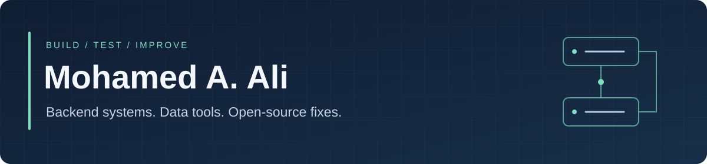
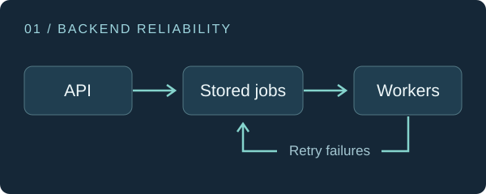
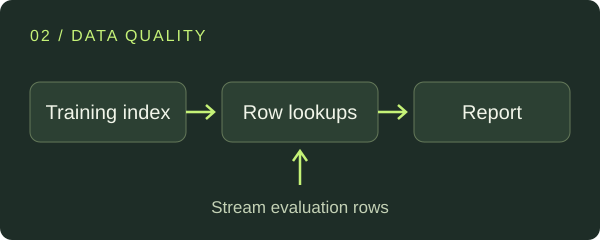

I build Python services and data tools, with a focus on reliable behaviour and clear tests.
My work includes webhook delivery, dataset checks and language-model evaluation.
I've also contributed accepted fixes to **[Black](https://github.com/psf/black/pull/5427)**
and **[urllib3](https://github.com/urllib3/urllib3/pull/5271)**.

**[Portfolio](https://mohamedajab.com)** &nbsp; / &nbsp; **[LinkedIn](https://www.linkedin.com/in/mohamed-aj/)** &nbsp; / &nbsp; **[Merged contributions](https://github.com/pulls?q=is%3Apr+author%3AMohamedajab+is%3Amerged+-user%3AMohamedajab)**

## Merged into other projects

| Project | What I changed | Review and code |
| --- | --- | --- |
| **Black** | Fixed formatting of long, quoted return types in functions with parameters; added regression tests. | [Merged PR #5427](https://github.com/psf/black/pull/5427) |
| **urllib3** | Stopped an ignored gzip decoding error from being raised again during cleanup. | [Merged PR #5271](https://github.com/urllib3/urllib3/pull/5271) |
| **Sotto** | Made search-result changes available to screen readers, with tests that check keyboard focus stays put. | [Merged PR #509](https://github.com/getsotto/sotto/pull/509) |
| **OpenMDAO Aviary** | Added tests that check dynamic-variable metadata stays in alphabetical order. | [Merged PR #1320](https://github.com/OpenMDAO/Aviary/pull/1320) |

## Selected projects

For backend work, start with **RelayForge**. For algorithms and data handling, try
**SplitCheck**. **Pressroom** shows a complete web application.

<table>
<tr>
<td width="50%" valign="top">

<h3><a href="https://github.com/Mohamedajab/relayforge">RelayForge</a></h3>

A webhook service that keeps track of deliveries, signs requests and retries when a receiver is unavailable. Workers can recover unfinished jobs after a crash.

<code>Python</code> <code>FastAPI</code> <code>PostgreSQL</code>

<a href="https://github.com/Mohamedajab/relayforge/blob/main/docs/evaluation-guide.md">Run the demo</a> · <a href="https://github.com/Mohamedajab/relayforge/blob/main/tests/test_postgres_integration.py">Read the database tests</a>

</td>
<td width="50%" valign="top">

<h3><a href="https://github.com/Mohamedajab/splitcheck">SplitCheck</a></h3>

A command-line tool that finds exact text matches and shared groups across ML dataset splits. It indexes training data, then checks evaluation rows one at a time using hash-based lookups.

<code>Python</code> <code>Data structures</code> <code>pytest</code>

<a href="https://github.com/Mohamedajab/splitcheck/blob/main/docs/ALGORITHM.md">Algorithm and memory benchmark</a> · <a href="https://github.com/Mohamedajab/splitcheck/blob/main/tests/test_streaming_audit.py">Streaming tests</a>

</td>
</tr>
</table>

### [Pressroom](https://github.com/Mohamedajab/pressroom) · Django publishing app

Authors draft, editors review, and only approved revisions go live. Includes revision
history, scheduled publishing, a REST API and PostgreSQL concurrency tests.

[Run it locally](https://github.com/Mohamedajab/pressroom#run-locally) ·
[Architecture](https://github.com/Mohamedajab/pressroom/blob/main/docs/architecture.md) ·
[Concurrency tests](https://github.com/Mohamedajab/pressroom/blob/main/tests/test_concurrency.py)

## Research

My [MSc research project](https://github.com/Mohamedajab/msc-llm-psychosis-benchmark)
examines language-model responses across multi-turn conversations. It includes an
evaluation workflow, annotation tools and offline verification, with demonstration
data kept separate from private research evidence.

## Tools I use

Python · SQL · PostgreSQL · FastAPI · Django · pytest · Docker · GitHub Actions

I also work with JavaScript and TypeScript for web interfaces and their tests.

---

Want to discuss a project or contribution? [Message me on LinkedIn](https://www.linkedin.com/in/mohamed-aj/).
